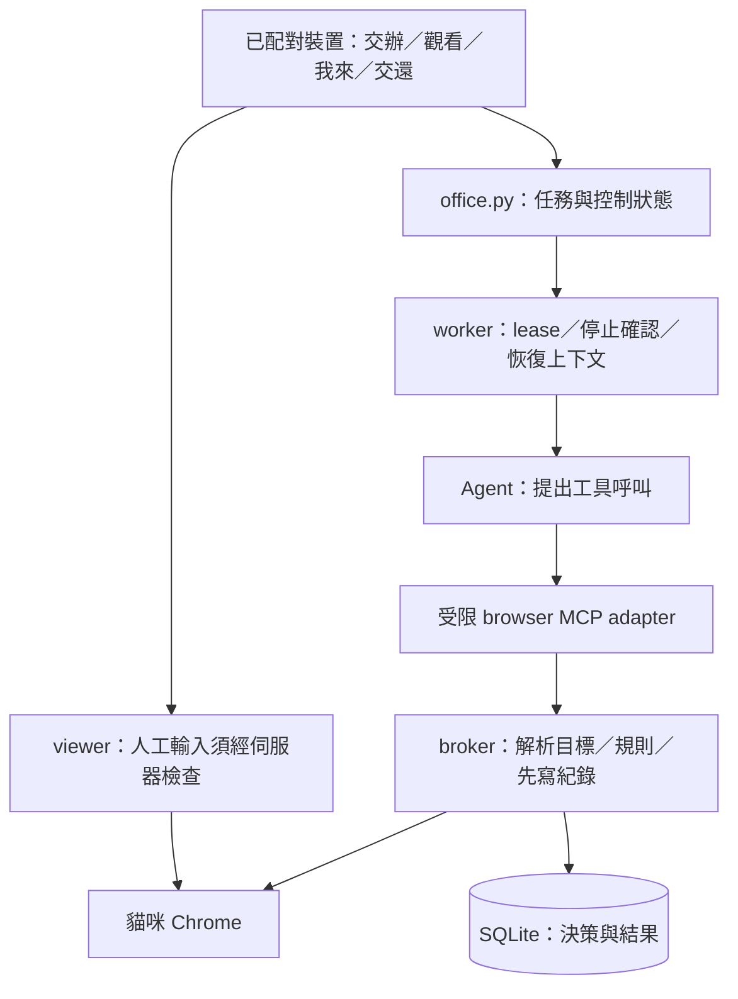
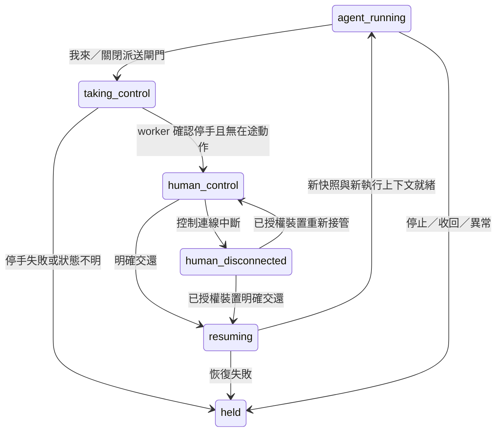

# ADR-002：瀏覽器動作控管、操作紀錄與接手

## 1. 決定與適用範圍

YUI 於 2026-10-26 要求將 OpenBot 值得借用的設計整合進既有規劃，尤其瀏覽器控管、紀錄與接手，交給 Claude 接續。採用以下設計方向，施工與驗收見 [Claude 交接](CLAUDE-HANDOFF-2026-10-26.md)。

1. 沿用 `office.py`、SQLite、現有任務／事件序號與單一 hands worker。規則先用固定、具版本的程式與設定，不引入 CEL、AG-UI、CopilotKit Intelligence 或新資料庫。
2. 新增由辦公室管理的 browser action broker。Agent 提案，broker 解析目標、驗證當前狀態、記錄決策並執行。worker 回報只算進度，不能替代可信任紀錄。
3. 接手延續 D12 的斷線持續暫停，採伺服器持久狀態、單一操作者、停止確認與控制世代，防止人與 Agent 同時操作，以及交還後重播舊動作。
4. D7 維持「不可逆動作由人親手做」，沒有「核准後 Agent 代按」端點；L4 維持不交給貓咪。
5. D13、D14 不變：v1 仍共用 neko-hands，仍不做全站網路白名單。因此第一階段只保證**經 broker 的工具呼叫**受控；不得宣稱已封住 Agent 的所有能力。

這是現有 PRD 的增補，涵蓋 H3／H4／H5／H6／H9，沒有另開第二套產品。D1–D14 除本文明確補充的接手實作細節外維持原決策。

## 2. 證據與要解決的落差

- 本次讀取 `office/hands/worker.py`：workspace-write、網路開啟、直接配置 browser MCP 並自動核准；heartbeat 約每 30 秒。工作區限制不等於網站操作限制。
- 現有 worker API 有 lease，保護舊輪次不能提交新輪次的成果；同 UID 的 agent 仍可能觸達 worker 資源，lease 不能當作惡意 Agent 的隔離保證（PRD 9.1 已說明）。
- H3-FIRST-TASK-2026-10-24 記錄真 Codex＋Chrome 任務完成；其餘 NOT RUN 不因本次文件變成通過。
- PRD 第 6 節的「工具先等著，交還後再繼續」過於模糊：凍結在舊工具呼叫中的程序，一恢復就可能送出過時動作。改成下文的停止、作廢、重新觀察流程。

參考 [OpenBot 固定版本架構](https://github.com/CopilotKit/OpenBot/blob/ef13020073e72913d3a216ae2cbbd6c97d33cade/docs/architecture.md) 的伺服器決策入口、先留紀錄與人工接手分工；[完整來源研究](../../../../../reports/OPENBOT_ARCHITECTURE_RESEARCH_2026-10-26.md)。以下契約是我們自己的設計，不是 OpenBot API。

## 3. 分層與保障邊界

| 邊界 | 第一階段驗收承諾 | 不可宣稱 |
|---|---|---|
| broker 工具路徑 | 每次 dispatch 前檢查 lease、控制世代、目標、規則，先留紀錄 | 其他路徑做不到同樣操作 |
| 現有同 UID 工作環境 | 專用低權限帳號；列出 CDP、profile、shell、網路、桌面等旁路 | token 不進 prompt 就等於不可被 Agent 取得 |
| 強制隔離模式（後續） | 須另修 D13，驗證 Agent 不能直連 CDP、讀 profile、注入 GUI／程序或繞 broker | 僅加第三帳號、反向代理或藏起連接埠就已成立 |

G0 必須產出能力路徑表與各項能／不能強制的證據。強制隔離另提設計與資源評估；不在本次文件自動批准系統帳號或網路變更。不得用「所有動作已受控」描述第一階段。

瀏覽器載入網頁本身可能觸發 JavaScript、GET 請求或先前已送出的操作；broker 控制的是工具 dispatch，不能保證網站零副作用，也無法撤回已送出的請求。

## 4. browser action broker 契約

### 4.1 身分與輸入

第一階段 adapter 只對 broker 發請求，不把原始 `chrome-devtools-mcp` 全套能力直接暴露給 Agent。建議模組：`office/browser_actions.py`（決策與 dispatch）、`office/browser_audit.py`（紀錄）、`office/hands/browser_adapter.py`（工具接合）；Claude 可依實際耦合調整檔名，保持這三項責任可辨識。

新增 worker socket 專用 `POST /api/worker/browser/action`，不可經公網或 owner 入口呼叫。沿用現有 JSON 大小上限，個別工具再設較小 schema 上限；拒絕未知欄位與工具。若 Python／Node adapter 無法在不暴露 raw CDP 下接現有 Chrome，先完成 mock broker 與測試，回報相容性缺口，不退回無條件放行。

| 請求欄位 | 規則 |
|---|---|
| `task_id, lease` | 當前 hands 任務與有效輪次；辦公室決定 owner／Agent／attempt |
| `action_id` | 每次意圖的 UUID；重送同號同內容回原狀態，不再 dispatch；內容不同回 409 |
| `control_epoch` | 呼叫者觀察到的世代；必須等於伺服器現值 |
| `tool, args` | 具型別、具大小上限；模型聲稱的風險／用途不作授權依據 |
| `snapshot_id, target_ref` | 需要頁面目標的工具必填，對應伺服器保存的 browser／tab／document generation；不接受任意 selector 假裝已解析 |

觸發來源由辦公室在建立任務時寫入：`person`、`handoff`，預留 `routine`、`system`；未接通的排程不因此啟用。人建立的長任務離線後仍可執行，`person` 表示起因，不表示有人正在觀看。

### 4.2 固定分類與結果

| 工具／情境 | 預設結果與限制 |
|---|---|
| 頁面快照、固定文字擷取、截圖 | 有效任務且未接手才允許；擷取用固定實作，不開任意 script；登入／接手期間停止 Agent 擷取與截圖 |
| 一般公開頁面導航 | 依既有帳號與網路範圍；明顯 action URL 不視為讀取；跳轉／文件換代後舊目標失效；不承諾導航無網站副作用 |
| 點擊、輸入、Enter、表單提交、上傳、下載 | 不以工具名稱或按鈕文字就認定安全。只允許固定 adapter 能辨識、具目標與效果範圍的操作；其餘 `needs_human` |
| 任意 `evaluate_script`、瀏覽器任意網路請求、未列出的工具 | broker 路徑拒絕；所需讀取能力以固定模板補上 |
| L2 對外寫入 | 僅固定、已授權的 adapter；GitHub 寫入維持 H4，只能 `neko/*`＋Draft PR；v1 不為泛用雲端表單開「任意寫入」 |
| 寄出／合併／刪除／代表使用者發言等 L3 | `needs_human`，只提供人工接手與目標頁；不發給 Agent 可執行的批准票券 |
| L4 | `deny`，不導入交易或主帳號登入；登入協助依 D3／D7 由人處理 |
| 不明／規則失效／目標已過時 | 不 dispatch；回明確原因，重新觀察或人工接手；禁止 fallback 到 raw MCP |

規則有 `policy_version`。優先序：停止／收回／失效 lease → 控制狀態不允許 → deny → needs_human → 明確 allow；沒有匹配規則就不執行。不是新增全站 domain 白名單；為固定 adapter 綁定目的地與參數是單次操作範圍，與 D14 分開。

下載／上傳另驗證 canonical path、symlink 與替換競態、大小、指定來源與去向；禁止提供任意主機路徑。上傳本身有資料外送效果；不得因為檔案可讀就自動允許外送。

### 4.3 執行、重送與失敗

1. 驗證任務、lease、epoch；解析目標時核對 browser／tab／document。依工具取得目前狀態，執行前再確認版本。無法避免目標變動的工具只能降級為人工操作。
2. 在辦公室鎖與 SQLite 交易中，保留唯一 `action_id`、寫入 decision、標記待執行。提交交易後才做外部 I/O；不持有 SQLite 交易等待整段瀏覽器操作。
3. dispatch 與接手共用每個 browser 的序列化閘門，派送前再次查 epoch／hold／撤銷。接手先關閘，不讓通過舊檢查的動作晚到。
4. 結束後另寫 outcome：`succeeded`、`failed`、`unknown`、`not_dispatched`。`allow` 不等於 `succeeded`；超時／斷線不能假設外部失敗。
5. 當 broker 重啟時，有 decision 卻無 outcome 的動作改成 `unknown`，先核對；未知副作用不自動重送。新 lease 也不能繞過原 action 的核對。
6. DB 無法先寫 decision，就拒絕新的 Agent dispatch。外部已執行但 outcome 寫入失敗時，封鎖該 session 新動作，待恢復後核對。停止與收回仍須能生效，不能因紀錄失敗而阻止緊急停止。

## 5. 操作紀錄：與進度事件分開

SQLite 新增 append-only 的 `browser_audit_events`（應用層不提供修改／刪除 API；不是防管理員竄改的宣稱）。decision／outcome／控制事件各自一列，以 `action_id` 或 `control_event_id` 關聯；現有 events.seq 只放安全摘要，供 WebSocket 補進度。不要把 heartbeat、lease、授權值或整段網頁內容轉抄進 UI。

| 欄位 | 來源與用途 |
|---|---|
| `seq, at, event_type` | 伺服器產生序號、UTC 時間與類型 |
| `task_id, attempt, agent_id, owner_id` | 從可信任任務資料決定，無任務的人工控制事件允許 task_id 為空 |
| `initiator_kind, initiator_id` | 任務起因，不採信模型輸入 |
| `browser_session_id, control_epoch, action_id` | 對應工作環境、接手世代與動作 |
| `tool, target_summary, policy_version, rule_id` | 實際解析結果與規則；URL 預設只記 origin，必要路徑用固定非敏感代號 |
| `decision, outcome, reason_code` | 允許／拒絕／需人／暫停，以及獨立的結果 |
| `provenance` | `broker_observed`、`worker_reported`、`human_control_event`；不把 Agent 自述當成已執行事實 |

紀錄不包含秘密、cookie、headers、lease、輸入框內容、鍵盤事件、query／fragment、帶秘密的路徑、任意 raw tool payload 或完整 stdout。禁止對低熵密碼／驗證碼做 hash 後存入紀錄。下載只留安全名稱／大小與任務內檔案代號。截圖不放在 audit JSON，登入／接手時不產生背景截圖，離開敏感頁後才恢復。

前端「詳細」依 task／action 顯示決策與結果，HTML escape；API 做 owner／配對裝置檢查、cursor 分頁與上限，worker 不能列出歷史或其他任務。第一版先做 JSON／UI，不為 CSV 增加範圍。清理工作區不刪 audit；保留策略沿用辦公室備份並另記錄，不偷偷宣稱永久保存。

## 6. 接手狀態與時序（H6 的實作契約）

狀態以 `browser_session_id` 持久化，不只掛在 task 上：共享的 Chrome 接手中，下一件任務也不能操作。至少保存 `state`、`control_epoch`、`controller_device_id`、當前 task／attempt、暫停計時、最近控制 heartbeat。更新採交易與 compare-and-swap；瀏覽器重建也必須更新 session／世代。

### 6.1 「我來」

1. `POST /api/viewer/control` body：`{operation_id, action:"take", expected_epoch}`。只接受有效配對裝置＋Origin＋現有寫入 token；公網與 local owner 入口沿用各自認證。worker 不可呼叫此端點。
2. 原子切到 `taking_control`、增加 epoch，先阻擋新 Agent 動作、作廢待執行動作、停擷取與截圖，記錄 `control_requested`。同一 operation_id 重送不增加第二次世代；相同 ID 不同內容回 409。
3. broker 模式的 worker 在獨立控制迴圈每至多 1 秒呼叫 heartbeat 讀取 `hold`／epoch，不能被長工具呼叫阻塞；原每 30 秒的更新仍可作 legacy 週期。1 秒是待量測的控制延遲預算，不是已驗證效能。worker 暫停／停止整個 Agent 程序樹及工具子程序，回覆同 lease／epoch 的停止確認。只停主 PID 不算完成；同 UID 程序可逃離管理範圍的情況列 G0 旁路，不能以這套協定宣稱已防住惡意程序。
4. broker 必須取消或等候已送出的動作結束；無法確認時保留 `held`，介面顯示「還在停手，先不要操作」，人工輸入仍關閉。停止確認期限先採 5 秒作為工程預算，超時不自動成功；實機量測後記錄調整理由。
5. 停手確認後才進入 `human_control`，開放該裝置輸入並記錄 `control_taken`。無法撤回之前已送出的網站請求；若其結果不明，先讓人看見狀態，不報成零副作用。

### 6.2 操作者、觀看與斷線

- viewer 的人工輸入必須在伺服器逐批驗證裝置、epoch 與 state；不能只靠 noVNC 的 viewOnly 屬性。原 PRD 的 viewOnly 防手滑仍可保留，但不足以維護多裝置單一控制者契約。
- 新裝置按「我來」時，原子換控制者並增加 epoch，關閉舊裝置輸入通道；舊連線晚到的按鍵與滑鼠拒絕。這沿用既有「另一台接手，原台只看」。
- 只看斷線不影響工作；控制者斷線持久化 `human_disconnected`，維持 hold，不以 timeout 自動交還。超過 2 分鐘按 D11 發「有 1 件等你」，同一 epoch 去重，不含內容。
- 辦公室／worker 重啟後，任何未明確交還或不能證明安全的 session 維持 hold；新 worker／新任務不能繞過。撤銷操作者裝置立即關輸入並轉 held，其他有效裝置可接管或交還。
- 人工接手期間只提供即時畫面，不背景錄製鍵盤、工具擷取、截圖或轉傳畫面給模型。背景網站本身繼續執行，不可說成整個網頁已凍結。

### 6.3 「交還」

1. 同端點 `{operation_id, action:"return", expected_epoch}`，由有效 owner 裝置明確送出；人離線不是 return。允許其他已配對裝置依目前 epoch 交還。
2. 進入 `resuming`、增加 epoch、關閉人工輸入；確認無尚未釐清的副作用，清掉接手前未執行／未完成的工具佇列、舊目標與快照。
3. 由固定 observer 取得新頁面快照。若仍在登入／敏感輸入畫面則維持 hold，請人完成；不要將密碼值或驗證碼送回 Agent。一般頁面也只提供任務必要且已遮蔽的上下文。
4. 舊程序若凍結在工具呼叫中，不能直接 SIGCONT。優先終止該 Agent turn，以原 task／有效 lease 加新 epoch、選定上下文及快照重啟；若要保留 turn，須證明取消舊呼叫並完成新觀察屏障的測試。
5. 成功後 `agent_running`、記錄 `control_released` 並繼續，不多一個「繼續」按鈕。失敗回 held，保留已做成果；不得回 legacy raw MCP 偷跑。

控制協定不可假設 worker 一定活著。heartbeat 回覆增補 `{hold, control_epoch, control_state}`，worker 在 hold 時仍續租；新增 worker-only `POST /api/worker/browser/control-ack`，body 為 `{task_id, lease, control_epoch, checkpoint:"stopped"|"observed", snapshot_id?}`，由辦公室驗證當前 lease、epoch、期望狀態與 broker 在途動作表，不單憑自述就打開閘門。`observed` 必須附 snapshot_id，關聯 broker 已產生且屬於同 session／epoch 的新快照，不能採信 worker 任意提供的頁面內容。舊版 worker 不認這些欄位時，不能啟用接手功能並宣稱已支援。

30 分鐘只計 Agent 有效執行時間；從 taking_control 到恢復成功的等待時間、需人登入時間排除。取消／收回仍結束任務，不因接手變成可恢復；交還不得復活已取消工作。實作需修現有 worker 的 monotonic 總計時，並測 lease 在 hold 期間不會被重領。

## 7. API 結果、相容性與上線開關

新端點建議結果：格式錯 400；身分／入口不符依既有 401／403／404；失效 lease、epoch、目標、重送內容衝突 409；規則 deny 403；需要人處理為 200＋`decision:"needs_human"`，不得帶成功結果；DB／broker 不可用 503。202 只代表 take／return 已受理，須查伺服器狀態才可顯示接手成功。

owner 端新增 `GET /api/viewer/state` 與 `GET /api/tasks/<id>/actions?after=&limit=`；不把原始 lease、CDP 位址或秘密放進回應。輸入事件須綁定已授權 WebSocket session 與 epoch；既有 `/api/ws` 只補安全狀態事件，不改舊進度事件格式。

新增 `browser_control_mode`：`legacy`（既有專用低權限試用）／`broker`（僅表示工具經新入口）。預設保留 legacy，開關不可偷偷替所有既有工作切模式；同一 task 固定模式、切換需新 task。broker 壞掉時 broker 任務停下來，不能 fallback。隔離是否已驗收另存能力旗標，由部署驗證決定，不能讓模型或一般請求自行設為 true。

遷移採新增表／欄位、可重跑，不改寫原任務／生活紀錄；先備份 SQLite。舊程式回退若不能理解 hold／epoch，不得接回該 Chrome：停用 hands 與 viewer 輸入，保留紀錄、先用唯讀辦公室。正式 VPS 部署與 mode 啟用需另有授權。

## 8. 施工與驗收對照

| ID | 接到既有 H | 交付與完成條件 |
|---|---|---|
| G0 | H3 | 能力路徑表、基準版本與 NOT RUN；列出同 UID／CDP／shell 等旁路，不以提示詞通過 |
| G1 | H2／H3 | 固定規則＋mock broker＋action_id／lease／epoch 檢查；壞規則、未知工具、舊目標、DB 故障均不 dispatch |
| G2 | H2／H4／H5 | 決策／結果分列、可信來源區分、敏感值不落盤、owner 專用分頁、SQLite 遷移與現有資料保留 |
| G3 | H3／H5 | 接真 Chrome 的受限 adapter；公開頁讀取可完成，L3 需人、L4 拒絕，禁止 raw fallback；只有 mock 不算完成 |
| G4 | H6 | 完整 take／ack／return 屏障、多裝置世代、斷線重啟持續 hold、重新觀察、不重播與計時 |
| G5 | H9 | 取消／撤銷／故障／回退演練、VPS 與 Mac／iPhone 分列結果；列出仍未封住的旁路 |

順序 G0 → G1 → G2 → G3 → G4 → G5；H4／H5 可共用 G1／G2 的紀錄介面，不能用它代替既有 GitHub 安全驗收。G1／G2 可先以本機合成環境完成，G3 與 G4 前先補 H3 現有缺項。

必要負向案例：同 action_id 不重複提交；換參數 409；lease／epoch 舊呼叫不動；導航換代後舊 ref 失效；dispatch 與 take 同時發生；在途結果不明不重試；agent／工具子程序未停時不開人工輸入；舊裝置晚到的輸入被拒；人工斷線、辦公室重啟、worker 重啟都不自動交還；hold 不耗 30 分鐘且續租；交還後第一個動作源自新觀察；取消後 return 不復活；紀錄系統故障時停止仍可用；惡意網頁／README 不能讓 broker 派出未授權動作。

使用虛構資料與合成站點測寄出／刪除／上傳效果，禁止拿真帳號試不可逆動作。證據依 ADR-001 第 8 節分成自動測試、模擬、實機與 NOT RUN；每項區分 broker 內的拒絕與 broker 外的繞過，未隔離不能寫「全面防護通過」。
