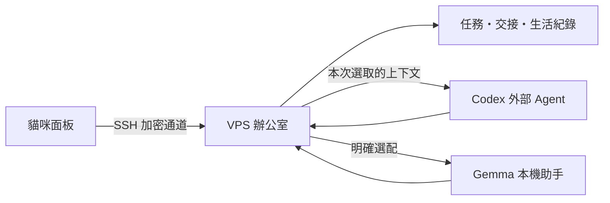

# 貓咪辦公室 v0.2 驗證紀錄

2026-10-21 · 獨立原型與真 VPS 驗證；正式語音 App 未替換，未提交、推送或發布。

## 結果

Gemma 已改為選配；預設新交辦交給 VPS 上的 Codex，使用本人完成的 ChatGPT OAuth 登入。任務、進度、成果、工作交接與生活原話由辦公室自己的 SQLite＋Markdown 保存，不依賴 Hermes 或 Codex 的全域記憶。

## 實測與證據

| 項目 | 結果 | 證據 |
|---|---|---|
| 舊資料遷移 | 7 件原任務的交辦、狀態、來源快照、模型、成果與成果位置一致 | [VPS 獨立讀回](remote-readback.json) |
| 離線測試 | Mac 與 VPS 各 33 項通過，含來源快照、冪等、取消、重啟、舊表遷移、選取式上下文與程序群組停止 | [Mac](offline-tests.txt)、[VPS](remote-tests-deploy.txt) |
| 原生既有模組 | AgentCore 16 情境、SSH 11 情境及參數解析、PreviewModel 生命週期／獨立設定回歸通過 | 本次工具執行結果；未將全專案測試聲稱為通過 |
| Codex 真整理 | 保留 10 月 25 日、300 元與「是否出門尚未決定」；10.022 秒 | [完整回應](codex-live.json) |
| Codex 交接續作 | 建立子任務，依人工交接重寫提醒；6.193 秒；父任務不覆寫 | [父子紀錄與快照](codex-live.json) |
| 原生面板生活紀錄 | 從面板輸入、保存、讀回；Gemma 關閉時可用 | [畫面](native-journal.png) |
| 原生面板交接 | 保存補充與下一步，重開面板後接續原任務，Codex 真實完成 | [任務](native-task.json)、[交接畫面](native-handoff.png)、[完成畫面](native-completed.png) |
| 成果下載 | 原生保存對話框下載到專案資料夾；與 API 及 VPS 檔案內容一致 | [下載原檔](native-result.md)，SHA256 `add61da36c670fad91f202a9c9c9f4c278db8f519e5d54da4ff544742ae2ef54` |
| 公開搜尋 | 實際查閱 OpenAI 官方文件，29.306 秒；記錄 6 個 web_search 事件（含啟動／完成，並非六個查詢） | [工具事件與成果](research-audit-live.json) |
| 關閉面板後繼續 | 關閉前為 running；Mac 18421 監聽結束，VPS 獨立完成，再重連讀回 | [關閉前](before-panel-close.json)、[VPS 完成紀錄](research-audit-live.json) |
| 未送出草稿 | 「離線」後本機埠釋放；重連後草稿仍在，測試後已清空 | [原生讀回](native-reconnect.txt) |
| Gemma 選配 | 明確選用後可啟動真 4B 模型、保留選定原文並保存結果；結束後已停止 | [結果](gemma-optional.json)；未將此一例當成完整品質評分 |
| 資料獨立讀回 | 四件 Codex 成果檔與 SQLite 一致；journal 逐筆與每日 Markdown 一致；integrity_check 為 ok | [VPS 檢查](remote-readback.json) |
| 部署與建置 | 最終 office/static/service 雜湊與 VPS 相同；原生預覽建置與 ad-hoc 簽署檢查通過 | [最終 manifest](final-manifest.json)、[建置](native-build.txt) |

未選取的合成生活紀錄 sentinel 沒有出現在對應任務上下文。此處證明的是程式實際組成的 prompt／快照，不代表對所有未來輸入的全面安全評估。測試紀錄保留於 VPS，原文含「合成驗證／面板驗證」標記，不是真實生活事件。

## 使用入口

- 已建置獨立 App：`/Users/panh.c/Desktop/What's up my neighbor/worktrees/neighbor-office-v1/build/office-preview/貓咪辦公室預覽.app`，bundle `tw.panh.NeighborOfficePreview`。
- 按「連線／重連」進辦公室。預設 Codex；Gemma 可在每件任務自行選取。
- 「生活紀錄」直接保存原話；回工作頁選取紀錄後才附給 Agent。
- 「工作交接」補上進展與下一步；「接續這件工作」附該任務的交接、原文快照與保存內容，另建子任務。
- [使用與維運說明](../../office/README.md)。也可使用既有瀏覽器入口或 VPS 桌面捷徑。

## 登入與修正紀錄

1. 本人帳號未啟用裝置碼登入。取消該流程，改用官方一般瀏覽器 OAuth 加 SSH loopback callback；本人完成，VPS 回報 Successfully logged in。沒有開啟安全設定、搬移 Mac 登入檔或建立 API key。
2. 首次公開搜尋因 CLI 缺少 `codex-code-mode-host` 而無法啟動。補裝同版官方 host 與 bwrap，逐一核對官方發行 SHA256 後重測成功。原失敗任務仍保留 needs_input，沒有改寫成完成。
3. Gemma 首次誤以為未提供選定生活原文。補上分類用原文節錄與已選原文的明確處理；後續真實執行成功。這仍是較弱的本機模型，內容請人工檢查。
4. 關閉原生 App 會關閉它擁有的 SSH 通道，因此當時依賴同一通道的本機驗證腳本失去連線；另以 VPS 端 HTTP 與磁碟獨立讀回確認工作完成，未以該腳本的中斷聲稱工作失敗。

## 保存與範圍

- VPS：`~/neighbor-office/data/office.sqlite3`、`tasks/<id>/result.md`、`handoff.md`、`journal/YYYY-MM-DD.md`。遷移前備份在 `~/neighbor-office/backups/office-v2-20261021T124049Z/`。
- Codex CLI／host 0.163.0 為官方固定版本與 checksum；獨立 CODEX_HOME，ephemeral 執行，明確上下文。停用 shell、外部 App／插件與子代理；只讀 sandbox、15 分鐘及事件容量上限。
- 外部能力目前為文字整理與公開資料研究；寄信、外部寫入、排程與操作桌面尚未接通。原有 VNC 與示範分頁保留。
- 「記憶」目前為人工選取交接與生活紀錄，尚無自動語意回憶、全生活史搜尋或自動記憶整理。更換 Agent 仍可沿用已保存資料。
- 外送內容是本次交辦、選定來源與明確選取的交接／生活紀錄，接收者為 OpenAI；受本人 ChatGPT 方案與額度限制。
- 最後檢查 office active；Ollama disabled/inactive，只有辦公室 8421 與 VNC 5901 的 loopback 監聽；未開新公網埠。VPS 閒置約 1.3 GiB 使用、6.4 GiB 可用。
- 未驗收：整機重新開機、長期自然使用、正式 App 安裝與發布。未覆寫正式 App 或既有已安裝預覽。
